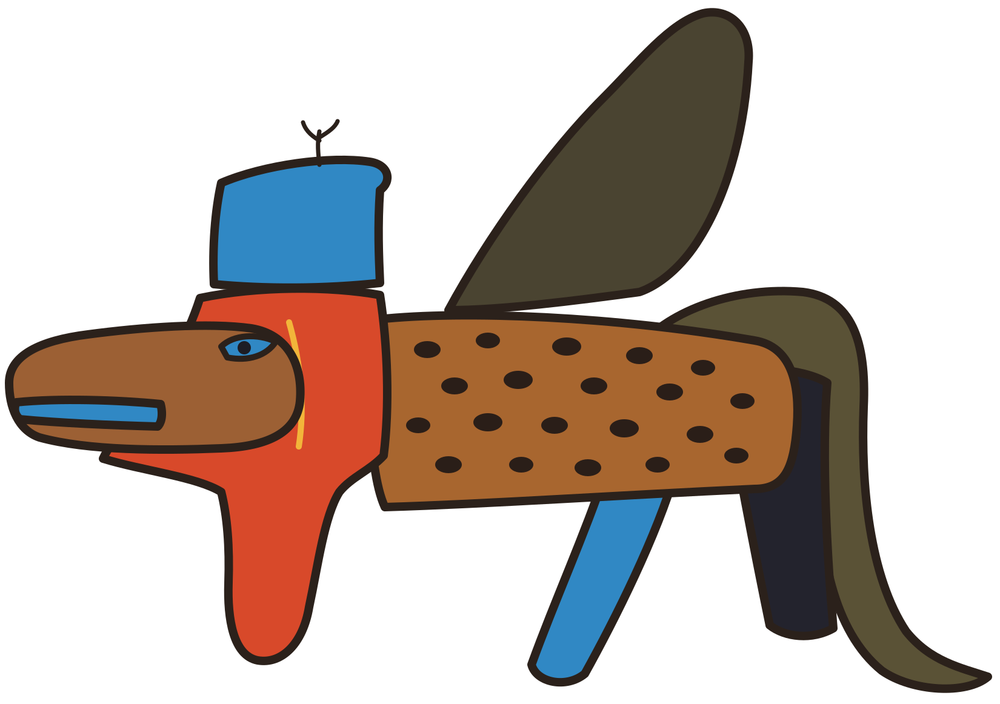
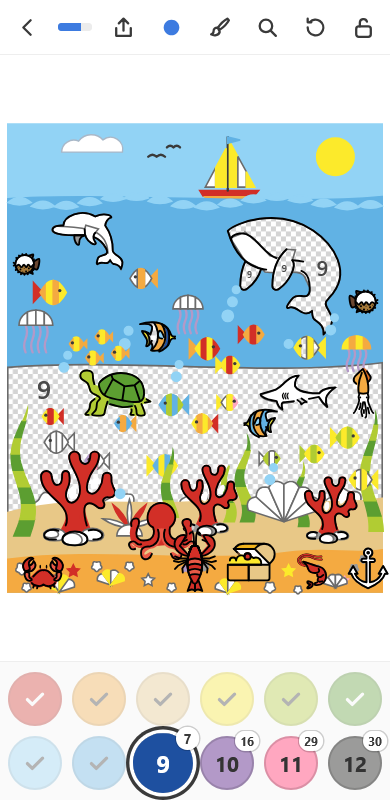
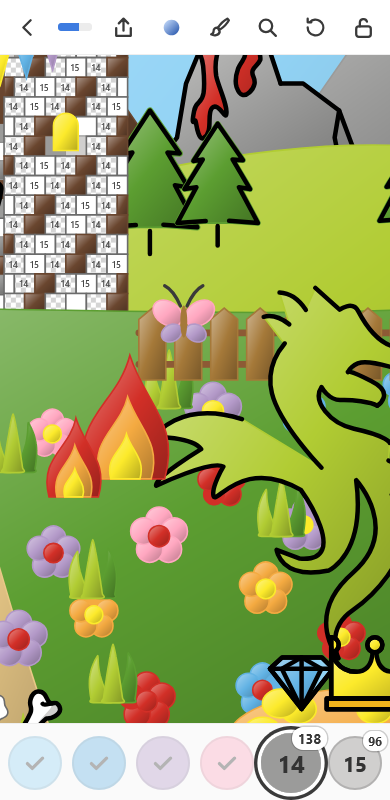
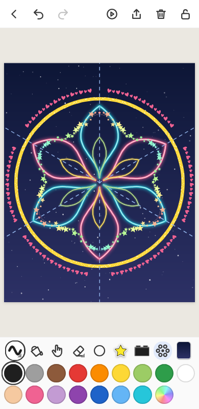
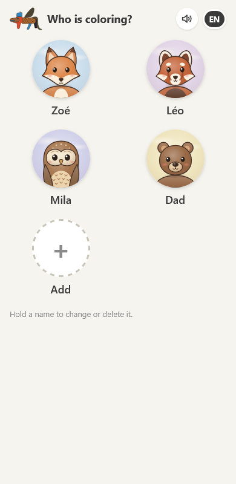
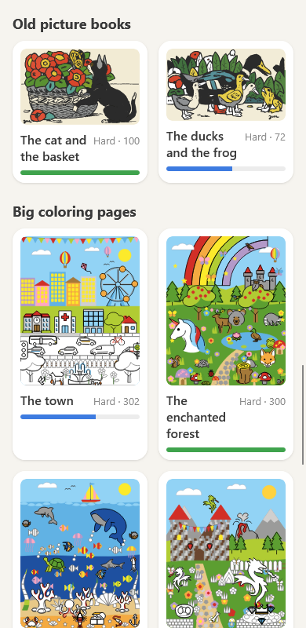
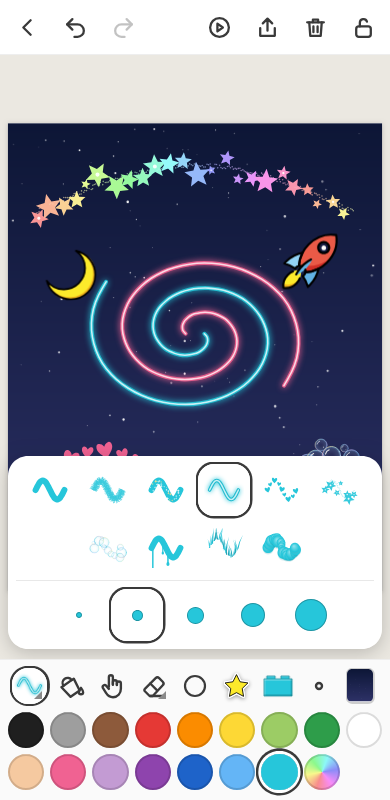
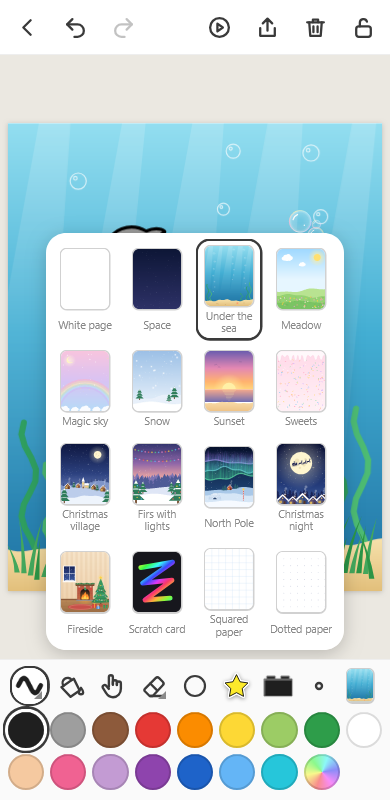

# Giuno Colors

**Color, draw and build. No ads, no account, no network needed.**

A coloring app for children that installs on a phone or a tablet like any other app and keeps working offline. Free and open source.

**Try it:** https://a220n1.github.io/giuno-colors/ then "Add to home screen" in the browser menu.

<p>
  
  
  
  
</p>

## For parents

*A phone you can hand over without watching the screen.*

- No ads and nothing to buy. Every page, brush and brick is there from the first day.
- No account. A first name and an animal make a profile, and nothing else is asked.
- Nothing leaves the phone. The app sends no data anywhere, and a drawing goes out only when someone presses Share.
- No network needed once it is installed, so it works in the car or on a plane.
- One profile per child, each with its own progress and drawings. A backup file moves everything to another phone.
- A session timer of 10 to 45 minutes. When the time is up, the app goes back to its start screen and says so.
- The phone's Back button never leaves the app, and a padlock keeps a small child inside a drawing.
- One button turns the sounds off. French or English.

<p>
  
  
</p>

## Color by number

*Pick a color, tap its numbers, watch the picture come.*

- 21 pages that grow with the child: 14 zones for the youngest, more than 600 for the patient ones.
- Six big scenes of 254 to 614 zones, among them a town, a coral reef and a valley of dragons.
- Two pages from French picture books of the 1920s, colored like the printed originals.
- Three mystery pages: all grey at first, the picture only shows as it is colored.
- Plain, shaded or glitter colors, at the tap of a button.
- Pinch to zoom up to ten times, hold a zone to pick its color, and a magnifier finds the zones left.

## Draw

*A blank page and a box of tricks.*

- Ten brushes: felt pen, pastel, glitter, neon, hearts, shooting stars, soap bubbles that fly off and pop, paint that drips, grass, clouds.
- A mirror that goes up to a kaleidoscope, where each stroke is drawn six times around the middle of the page.
- Sixteen pages to draw on: space, an underwater scene, five Christmas landscapes, squared paper, and a scratch card whose black hides bright colors.
- 85 stickers, with a Christmas page, and your own: cut-out photos of the family go in from a file.
- Stencils, shapes, a paint bucket, a finger that smudges, and a replay of the drawing stroke by stroke.
- Any coloring page also opens as a page to paint freely.
- Shake the phone and it snows.

<p>
  
  
</p>

## Build

*Bricks that click.*

- 25 pieces in any color: bricks, plates, slopes, an arch, a wheel, a door, a window, a flag, a head with a smile.
- They snap to the studs and stack. Hold one to move it; a tap of the eraser takes it away.
- Four models to build over: a dragon, a castle, a rocket, a fir.

## Make your own

The app is plain HTML, CSS and JavaScript, built by one Python script with nothing to install:

```sh
python3 build.py --out site
python3 -m http.server --directory site 8000
```

How to add drawings, stickers and sticker packs, and how the tests run: [docs/making.md](docs/making.md).

## License

The code is under the GNU General Public License, version 3 or later (see `LICENSE`). The drawings in `drawings/`, the animal avatars in `src/avatars/` and the logo and icons in `icons/` are under CC BY-SA 4.0, and the stickers in `src/stamps/` are OpenMoji emojis and Christmas stickers drawn for the app, all under CC BY-SA 4.0 (see `LICENSE-ART.md`).
